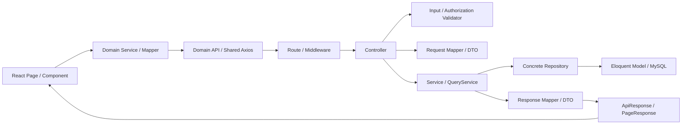
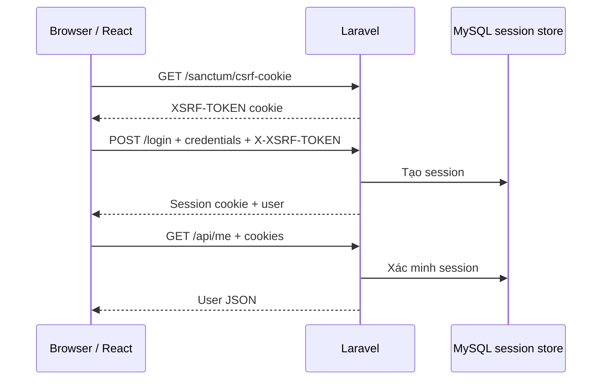
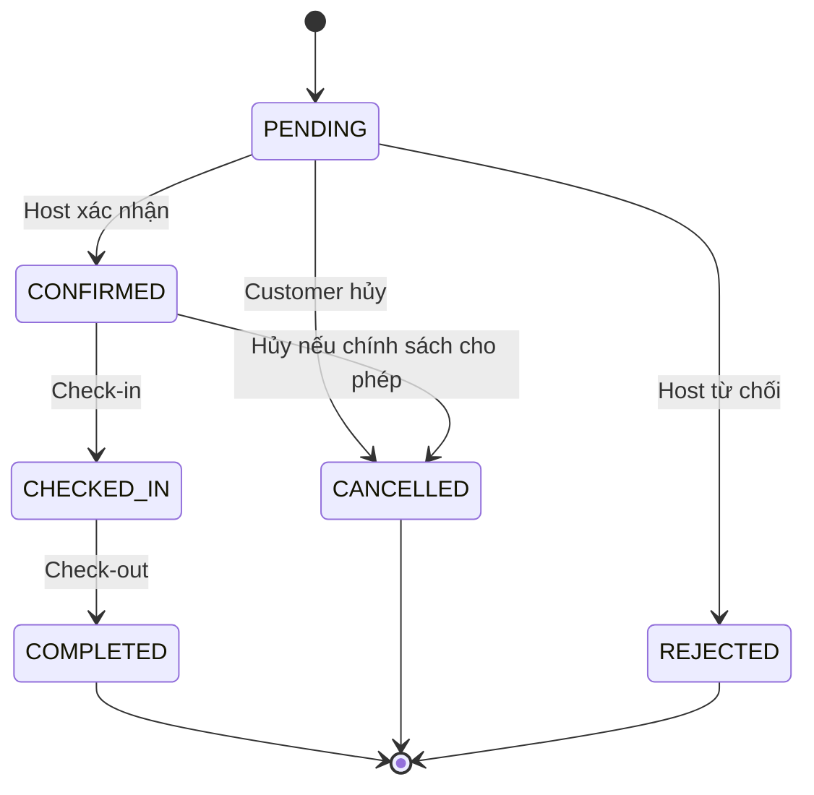
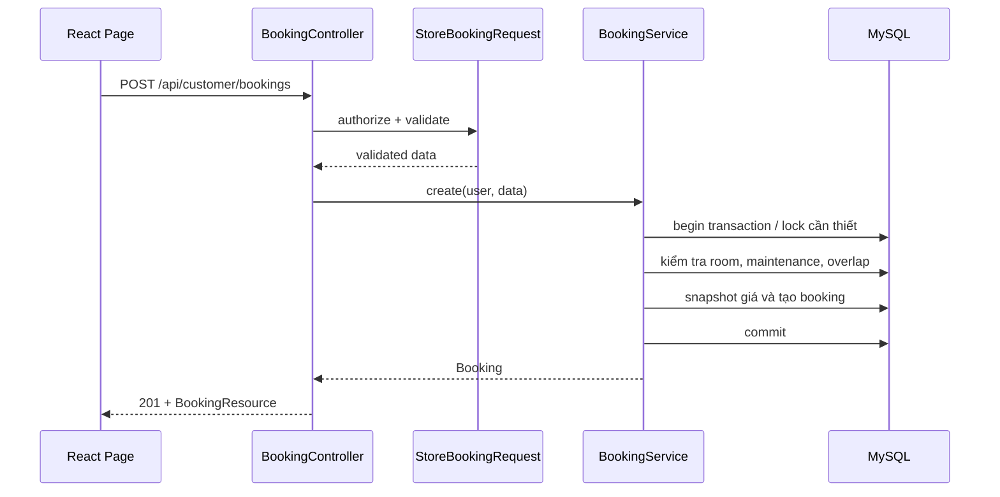

# Kiến trúc hệ thống StayHub

Tài liệu này mô tả kiến trúc kỹ thuật của StayHub, ranh giới giữa frontend và backend, cấu trúc thư mục của từng ứng dụng, luồng dữ liệu, quy tắc nghiệp vụ và định hướng mở rộng khi triển khai các module tiếp theo.

> **Trạng thái tài liệu:** quy ước hiện hành sau SIMPLIFY-01A/B nằm ở mục 4, 13 và 14. Inventory khởi tạo được đánh dấu lịch sử; target toàn dự án không có nghĩa mọi module đã migrated. Code và contract thực tế được ưu tiên khi triển khai task.

## 1. Tổng quan hệ thống

StayHub được tổ chức theo mô hình monorepo gồm hai ứng dụng độc lập:

- `frontend/`: Single Page Application (SPA) viết bằng React và Vite;
- `backend/`: REST API viết bằng Laravel, đồng thời quản lý xác thực session bằng Sanctum;
- MySQL: nơi lưu dữ liệu nghiệp vụ và session;
- dịch vụ AI/LLM: thành phần tùy chọn cho chatbot, chỉ được gọi thông qua backend.

Ở mức triển khai, đây là kiến trúc **client-server tách biệt**. Ở mức mã nguồn backend, hệ thống đi theo hướng **modular monolith có phân lớp**: các module nghiệp vụ cùng chạy trong một ứng dụng Laravel nhưng được tách theo trách nhiệm.



Sơ đồ mô tả target đã áp dụng cho Invoice read/create. Validator được gọi trước mapper/service; business validator có thể được Service sử dụng. Module legacy được liệt kê ở mục 14; sơ đồ không cấp quyền tự chuyển chúng.

### Ranh giới trách nhiệm

| Thành phần | Chịu trách nhiệm | Không chịu trách nhiệm |
| --- | --- | --- |
| Frontend | hiển thị UI, điều hướng, thu thập input, trạng thái giao diện, gọi API | quyết định quyền truy cập, tính giá cuối cùng, xác nhận phòng trống |
| Backend | xác thực, phân quyền, validation, nghiệp vụ, transaction, chuẩn hóa response | phụ thuộc vào việc frontend đã ẩn/hiện nút đúng hay chưa |
| Database | lưu dữ liệu, khóa ngoại, unique/index, tính toàn vẹn cơ bản | thay thế validation và authorization ở backend |
| AI/LLM | sinh câu trả lời từ ngữ cảnh backend cung cấp | truy cập trực tiếp database hoặc tự ý tạo/hủy booking |

## 2. Cấu trúc repository

```text
stayhub/
├── backend/                         # Ứng dụng Laravel 12 (REST API & Sanctum)
├── frontend/                        # Ứng dụng React 19 + Vite (SPA chính thức của StayHub)
├── docs/                            # Tài liệu phân tích, thiết kế & template UI
│   ├── stayhub-erd.md               # ERD và data dictionary mục tiêu
│   ├── stayhub-screen-mockups.md    # Danh sách màn hình và thiết kế UI
│   ├── stayhub-usecase-system.md    # Actor, use case và luồng nghiệp vụ
│   ├── stayhub-team-work-assignment.md # Phân công trách nhiệm 3 thành viên (TV1, TV2, TV3)
│   ├── seed-data.md                 # Dữ liệu mẫu khởi tạo hệ thống
│   ├── ai-frontend-development-guide.md # Hướng dẫn AI phát triển Frontend & tái sử dụng template
│   └── StayNest-Frontend-template/  # Template giao diện tham khảo (React 19 + Tailwind v4)
├── ARCHITECTURE.md                  # Tài liệu kiến trúc này
└── README.md                        # Giới thiệu và cách chạy dự án
```

Hai thư mục `frontend/` và `backend/` có dependency, lệnh build và tiến trình chạy riêng. Không import mã nguồn trực tiếp qua lại giữa hai ứng dụng; hợp đồng tích hợp là HTTP/JSON.

## 3. Kiến trúc frontend

### 3.1 Công nghệ và kiểu kiến trúc

- React 19 xây dựng giao diện theo component;
- Vite 8 cung cấp dev server và đóng gói production;
- React Router DOM 7 điều hướng phía client;
- Axios làm HTTP client;
- JavaScript/JSX;
- ESLint kiểm tra chất lượng mã nguồn.

Frontend đi theo kiến trúc **component-based kết hợp route/layout và service layer**:

```text
main.jsx
  -> BrowserRouter
    -> App.jsx
      -> AppRouter.jsx
        -> Layout theo nhóm người dùng
          -> Page
            -> Feature/Common Component
              -> Service
                -> Axios Client
                  -> Laravel API
```

### 3.2 Cấu trúc frontend khởi tạo (inventory lịch sử)

Cây/route dưới đây là snapshot khởi tạo, không phải inventory runtime hiện hành. Invoice API/error/service chung create-read/mapper hiện có được ghi tại mục 13.4 và 14; kiểm tra AppRouter thực tế trước task.

```text
frontend/
├── public/                          # Static assets phục vụ nguyên trạng (khi có)
├── src/
│   ├── api/
│   │   └── axios.js                 # Axios instance dùng chung
│   ├── assets/                      # Ảnh, font, icon được bundler xử lý
│   ├── components/
│   │   ├── admin/                   # Component riêng cho Admin
│   │   ├── common/                  # Component tái sử dụng toàn hệ thống
│   │   ├── customer/                # Component riêng cho Customer
│   │   └── host/                    # Component riêng cho Host
│   ├── hooks/                       # Custom React hooks
│   ├── layouts/
│   │   ├── AdminLayout.jsx
│   │   ├── CustomerLayout.jsx
│   │   ├── HostLayout.jsx
│   │   └── PublicLayout.jsx
│   ├── pages/
│   │   ├── admin/
│   │   │   └── AdminDashboardPage.jsx
│   │   ├── customer/
│   │   │   └── CustomerDashboardPage.jsx
│   │   ├── host/
│   │   │   └── HostDashboardPage.jsx
│   │   └── public/
│   │       ├── ApiTestPage.jsx
│   │       ├── HomePage.jsx
│   │       └── LoginTestPage.jsx
│   ├── routes/
│   │   └── AppRouter.jsx            # Khai báo route và layout
│   ├── services/                    # Đang trống, dành cho API theo module
│   ├── utils/                       # Đang trống, helper thuần
│   ├── App.jsx                      # Root component
│   ├── index.css                    # CSS toàn cục
│   └── main.jsx                     # Entry point, mount React
├── .env                             # Biến môi trường local, không commit
├── eslint.config.js
├── index.html
├── package.json
└── vite.config.js
```

Các route hiện có:

| URL | Layout | Page | Trạng thái bảo vệ |
| --- | --- | --- | --- |
| `/` | `PublicLayout` | `HomePage` | public |
| `/api-test` | `PublicLayout` | `ApiTestPage` | public, dùng kiểm tra kết nối |
| `/login-test` | `PublicLayout` | `LoginTestPage` | public, dùng kiểm tra Sanctum |
| `/customer` | `CustomerLayout` | `CustomerDashboardPage` | chưa có route guard frontend |
| `/host` | `HostLayout` | `HostDashboardPage` | chưa có route guard frontend |
| `/admin` | `AdminLayout` | `AdminDashboardPage` | chưa có route guard frontend |

### 3.3 Trách nhiệm từng lớp frontend

#### `pages/`

Page đại diện cho một màn hình gắn với URL. Page được phép điều phối dữ liệu và trạng thái của màn hình, nhưng không nên chứa chi tiết cấu hình Axios hoặc lặp lại logic gọi API.

#### `layouts/`

Layout định nghĩa khung giao diện dùng chung cho từng vùng public, customer, host và admin. `Outlet` là vị trí render page con. Layout có thể chứa navbar, sidebar và footer, nhưng kiểm tra quyền thật sự vẫn phải diễn ra tại backend.

#### `components/`

- `common/`: button, modal, table, pagination, loading, error state;
- `customer/`, `host/`, `admin/`: component chỉ dùng trong phạm vi vai trò tương ứng.

Component nên nhận dữ liệu qua props và phát sự kiện; không nên tự biết quá nhiều về URL API nếu logic đó có thể đặt trong service.

#### `services/`

Đây là lớp giao tiếp với backend theo module. Kiến trúc mục tiêu:

```text
services/
├── authService.js
├── propertyService.js
├── roomService.js
├── bookingService.js
├── invoiceService.js
├── reviewService.js
└── chatbotService.js
```

Page gọi hàm nghiệp vụ như `bookingService.create(payload)` thay vì gọi `axios.post(...)` rải rác. Service chịu trách nhiệm endpoint và tham số; page chịu trách nhiệm trạng thái loading/success/error.

#### `api/axios.js`

Axios instance hiện đọc `VITE_BACKEND_URL`, gửi header `Accept: application/json`, cookie (`withCredentials`) và XSRF token (`withXSRFToken`). Vì `/login` và `/sanctum/csrf-cookie` nằm ngoài `/api`, base URL nên là origin backend, ví dụ `http://localhost:8000`; các API nghiệp vụ phải gọi với tiền tố `/api/...`.

#### `hooks/` và `utils/`

- hook chứa logic React có thể tái sử dụng, ví dụ `useAuth`, `usePagination`;
- utility là hàm thuần, ví dụ format tiền/ngày hoặc ánh xạ trạng thái;
- không đặt business rule quan trọng chỉ ở hai thư mục này vì backend mới là source of truth.

### 3.4 Cấu trúc frontend mục tiêu khi mở rộng

Dưới đây là cấu trúc mở rộng hoàn chỉnh của `frontend/src/` cho toàn bộ các use cases và 3 vai trò:

```text
frontend/
├── public/                          # Static assets phục vụ nguyên trạng
├── src/
│   ├── api/                         # Giao tiếp HTTP với Laravel REST API
│   │   ├── axios.js                 # Axios instance (baseURL, withCredentials, XSRF token)
│   │   ├── authApi.js               # /login, /register, /logout, /api/me
│   │   ├── propertyApi.js           # /api/public/properties, /api/host/properties, rooms
│   │   ├── bookingApi.js            # /api/customer/bookings, search, availability
│   │   ├── invoiceApi.js            # /api/host/invoices, /api/customer/invoices
│   │   ├── reviewApi.js             # /api/customer/bookings/{id}/review
│   │   └── chatbotApi.js            # /api/customer/chat/sessions, messages
│   │
│   ├── assets/                      # Ảnh banner, logo, icon tĩnh
│   │
│   ├── components/                  # Thư viện component phân tách theo domain
│   │   ├── common/                  # Component dùng chung (Navbar, Footer, Pagination, Modal, Loading, ErrorState)
│   │   ├── ui/                      # UI primitives tái sử dụng (Button, Input, Dialog, Calendar, Table, Badge, Card...)
│   │   ├── customer/                # Component dành cho khách (SearchForm, RoomCard, BookingSummary, InvoiceCard...)
│   │   ├── host/                    # Component dành cho Host (PropertyEditor, RoomTable, MaintenanceDialog, ServiceManager...)
│   │   ├── admin/                   # Component dành cho Admin (UserManagementTable, PropertyAuditCard, RevenueChart...)
│   │   └── chatbot/                 # Khung chat AI, bong bóng tin nhắn, danh sách gợi ý
│   │
│   ├── contexts/                    # React Contexts
│   │   └── AuthContext.jsx          # Trạng thái đăng nhập toàn cục & thông tin User hiện tại
│   │
│   ├── hooks/                       # Custom React Hooks
│   │   ├── useAuth.js               # Hook truy xuất AuthContext tiện lợi
│   │   ├── useAvailability.js       # Hook tính ngày trống và kiểm tra overlap
│   │   └── useDebounce.js           # Hook tối ưu tìm kiếm theo thời gian thực
│   │
│   ├── layouts/                     # Khung sườn layout theo nhóm quyền
│   │   ├── AdminLayout.jsx          # Sidebar Admin + Header + Outlet
│   │   ├── HostLayout.jsx           # Sidebar Host + Header + Outlet
│   │   ├── CustomerLayout.jsx       # Header Customer + Footer + Outlet
│   │   └── PublicLayout.jsx         # Header công khai cho khách chưa đăng nhập
│   │
│   ├── pages/                       # Màn hình gắn liền với các route
│   │   ├── public/                  # HomePage, SearchResultsPage, PropertyDetailPage, RoomDetailPage, LoginPage, RegisterPage
│   │   ├── customer/                # CustomerDashboardPage, MyBookingsPage, BookingDetailPage, CustomerInvoicesPage, CustomerProfilePage
│   │   ├── host/                    # HostDashboardPage, HostPropertiesPage, HostRoomsPage, HostBookingsPage, HostInvoicesPage, HostServicesPage
│   │   └── admin/                   # AdminDashboardPage, AdminUsersPage, AdminPropertiesPage, AdminBookingsPage, AdminInvoicesPage
│   │
│   ├── routes/                      # Bộ định tuyến React Router DOM
│   │   ├── AppRouter.jsx            # Định nghĩa toàn bộ route cây của ứng dụng
│   │   ├── ProtectedRoute.jsx       # Chặn chuyển trang nếu chưa đăng nhập
│   │   └── RoleRoute.jsx            # Chặn chuyển trang nếu không đúng role (ADMIN, HOST, CUSTOMER)
│   │
│   ├── services/                    # Tầng xử lý logic nghiệp vụ phía client (chuẩn hóa dữ liệu trước/sau khi gọi API)
│   ├── utils/                       # Hàm tiện ích thuần (formatVND, formatDate, validateHelper)
│   ├── App.jsx                      # Root Application component
│   ├── index.css                    # Toàn cục stylesheet & typography
│   └── main.jsx                     # Entry point React 19 mount vào #root
├── .env                             # VITE_BACKEND_URL=http://localhost:8000
├── eslint.config.js
├── index.html
├── package.json
└── vite.config.js
```

`ProtectedRoute` chỉ cải thiện trải nghiệm điều hướng. Nó không thay thế `auth:sanctum`, middleware role, policy và ownership check ở backend.

### 3.5 Mối quan hệ với template tham khảo `StayNest-Frontend-template`

Thư mục `docs/StayNest-Frontend-template/` chứa mã nguồn giao diện mẫu hoàn chỉnh (React 19, Tailwind CSS v4, shadcn/ui components, animations) được tích hợp làm nguồn tham khảo thị giác cho toàn bộ giao diện:

#### Cấu trúc thư mục của template mẫu:

```text
docs/StayNest-Frontend-template/
├── src/
│   ├── assets/                      # Ảnh mẫu, hero banners, logos
│   ├── components/
│   │   ├── auth/                    # Form Auth mẫu (LoginForm, SignupForm, ResetPassword)
│   │   ├── bookings/                # BookingCard, BookingStatusBadge, CancelBookingDialog
│   │   ├── guests/                  # GuestSelector, SavedGuestsPreview
│   │   ├── hotel/                   # HotelHeader, RoomsList, ReviewList, AmenityGrid
│   │   ├── landing/                 # HeroSection, FeaturedHotels, SearchBar
│   │   ├── manager/                 # Bảng điều khiển quản lý của Host / Manager
│   │   │   ├── tabs/                # OverviewTab, RoomsTab, InventoryTab, BookingsTab, ReportsTab, SettingsTab
│   │   │   ├── HotelProfileForm.jsx # Form thông tin cơ sở
│   │   │   ├── InventoryCalendar.jsx# Lịch phòng trống trực quan
│   │   │   ├── PhotoUploader.jsx    # Component upload ảnh
│   │   │   ├── RequireManager.jsx   # Route guard cho vai trò Manager
│   │   │   └── RoomFormDialog.jsx   # Dialog thêm/sửa phòng
│   │   ├── profile/                 # ProfileHeader, PersonalInfoCard, EditProfileDialog, MyReviewsSection
│   │   ├── search/                  # AssistantPanel (AI chatbot), ConversationalSearchBox, FilterSidebar, ResultsGrid, SearchHotelCard
│   │   ├── ui/                      # 40+ shadcn/ui primitives (button, dialog, calendar, table, popover, sheet, tabs, sonner...)
│   │   └── RootLayout.jsx           # Layout shell với Navbar & session watcher
│   ├── hooks/
│   │   ├── queries/                 # React Query data fetching hooks (useHotelSearch, useMyBookings...)
│   │   │   └── manager/             # useRooms, useManagerHotel, useReservations...
│   │   ├── useAuth.js
│   │   └── use-mobile.jsx
│   ├── lib/
│   │   ├── api/                     # API client layer mẫu (client.js, hotels.js, bookings.js, admin.js...)
│   │   └── utils.js                 # Helper hàm `cn()` (clsx + tailwind-merge)
│   ├── routes/                      # Màn hình định tuyến phẳng theo file
│   │   ├── index.jsx                # Landing page
│   │   ├── search.jsx               # Kết quả tìm kiếm + AI assistant panel
│   │   ├── hotels.$hotelId.jsx      # Chi tiết khách sạn & danh sách phòng
│   │   ├── checkout.$bookingId.jsx  # Đặt phòng & thanh toán
│   │   ├── bookings.index.jsx       # Danh sách booking cá nhân
│   │   ├── bookings.$bookingId.jsx  # Chi tiết booking
│   │   ├── profile.jsx              # Hồ sơ cá nhân
│   │   └── manage.jsx               # Manager console (Hotels, Rooms, Bookings, Reports)
│   ├── styles.css                   # Tailwind CSS v4 design tokens & CSS variables
│   ├── App.jsx                      # App root router
│   └── main.jsx                     # Entry point
├── package.json
└── vite.config.js
```

#### Bảng ánh xạ tái sử dụng từ template sang `frontend/`:

| Module StayHub | Thành phần tham khảo từ StayNest template | Vị trí chuyển đổi trong `frontend/src/` |
| --- | --- | --- |
| **UI Primitives** | `components/ui/` (button, dialog, calendar, input, table, badge, sheet...) | `components/ui/` hoặc `components/common/` |
| **Tìm kiếm & Availability** | `components/search/` (FilterSidebar, SearchHotelCard, ResultsGrid) | `pages/public/SearchResultsPage.jsx`, `components/customer/` |
| **Quản lý của Host** | `components/manager/` (ManagerShell, InventoryCalendar, RoomFormDialog, tabs) | `pages/host/`, `components/host/` |
| **Booking & Checkout** | `components/bookings/`, `routes/checkout.$bookingId.jsx` | `pages/customer/BookingDetailPage.jsx`, `components/customer/` |
| **Hồ sơ & Đánh giá** | `components/profile/` (PersonalInfoCard, MyReviewsSection, EditProfileDialog) | `pages/customer/CustomerProfilePage.jsx` |
| **Chatbot AI** | `components/search/AssistantPanel.jsx` | `components/chatbot/AssistantPanel.jsx` |

#### Nguyên tắc làm việc với template:
1. **Ranh giới thực thi**: Không chạy hoặc import trực tiếp từ `docs/StayNest-Frontend-template/` trong runtime của `frontend/`.
2. **Cách kế thừa**: Khi xây dựng màn hình trong `frontend/`, sao chép component cần thiết từ template sang `frontend/src/`, điều chỉnh styling và nối với API endpoint thật của Laravel backend StayHub.
3. **Chi tiết chỉ dẫn**: Tuân thủ nghiêm ngặt theo tài liệu [ai-frontend-development-guide.md](docs/ai-frontend-development-guide.md).

## 4. Kiến trúc backend

### 4.1 Công nghệ và kiểu kiến trúc

PHP 8.2+, Laravel 12, Sanctum session/cookie, Eloquent, MySQL, Composer và PHPUnit. Backend là modular monolith phân lớp. Quyết định SIMPLIFY-01A/B đơn giản hóa target Repository + DTO + Mapper toàn dự án; Invoice read/create đã chuyển qua các checkpoint 01/02; module khác chuyển theo scope riêng, parent refactor vẫn chờ nghiệm thu tổng hợp.

```text
Route -> Middleware -> Controller
                         -> Input/Authorization Validator
                         -> Request Mapper -> Request DTO
                         -> Service/QueryService -> Concrete Repository -> Eloquent/MySQL
Service result -> Response Mapper -> Response DTO (JsonSerializable)
               -> Controller -> Common ApiResponse/PageResponse -> JSON
```

### 4.2 Cấu trúc backend hiện có

Inventory tập trung vào boundary refactor hiện hành, không liệt kê mọi module:

```text
backend/app/
├── Common/{ApiResponse,PageResponse,Constants}.php
├── Http/
│   ├── Controllers/
│   │   ├── Controller.php
│   │   ├── Auth/AuthController.php
│   │   ├── Profile/ProfileController.php
│   │   ├── Invoice/{HostInvoiceController,CustomerInvoiceController}.php
│   │   └── Review/{CustomerReviewController,HostReviewController,PublicReviewController}.php
│   ├── Requests/{Auth,Profile,Review}/     # Legacy consumers, giữ nguyên
│   └── Resources/{Auth,Review}/           # Legacy consumers ngoài Invoice
├── DTOs/Invoice/
│   ├── Requests/{InvoiceFilterRequest,InvoiceCreateInputRequest,InvoiceIdInputRequest,InvoiceQueryInputRequest,CreateInvoiceRequest}.php
│   └── Responses/{InvoiceResponse,InvoiceItemResponse}.php
├── Mappers/Invoice/InvoiceMapper.php
├── Repositories/Invoice/InvoiceRepository.php
├── Services/Invoice/{InvoiceQueryService,InvoiceService,InvoiceCalculationService}.php
├── Validators/
│   ├── AttributeValidator.php
│   ├── Constraints/{CanonicalPositiveId,CanonicalPositiveIdValidator}.php
│   ├── Invoice/{InvoiceValidator,InvoiceCalculationValidator}.php
│   └── Review/ReviewCreationValidator.php
├── Exceptions/{AppException,ErrorCode,GlobalExceptionHandler}.php
├── Exceptions/Invoice/DuplicateInvoiceException.php
├── Mapping/EloquentObjectMapper.php
├── Models/                              # Eloquent, relationships/casts/scopes
└── Providers/AppServiceProvider.php
```

Invoice read/create không còn Http/Requests hoặc Http/Resources riêng; Invoice Resources đã xóa ở 02C.1. Auth/Profile/Review giữ Request/Resource hiện hữu theo consumer thực tế. Base Controller phải tồn tại khi lớp con còn extends Controller. Routes/URL không đổi, không tự thêm /api/v1 hoặc chuyển namespace Controller.

### 4.3 Cấu trúc backend mục tiêu (Tổ chức theo cụm chức năng / Domain Modules)

Các thư mục Controllers, Services, Validators, DTOs, Mappers và Repositories tổ chức theo domain. Với module mới hoặc migration được duyệt:

```text
app/
├── Http/Controllers/<Domain>/*Controller.php
├── DTOs/<Domain>/
│   ├── Requests/*Request.php
│   └── Responses/*Response.php          # JsonSerializable, explicit public fields
├── Validators/<Domain>/*Validator.php
├── Mappers/<Domain>/*Mapper.php
├── Repositories/<Domain>/*Repository.php # Concrete, một file mặc định/domain
├── Services/<Domain>/*Service.php
├── Common/{ApiResponse,PageResponse,Constants}.php
├── Exceptions/{AppException,ErrorCode,GlobalExceptionHandler}.php
└── Providers/AppServiceProvider.php
```

Không tự sinh interface/implementation đôi, Contracts/Eloquent, module provider hoặc generic CRUD BaseRepository. Concrete class được inject qua constructor và Laravel tự resolve khi dependencies resolve được. Interface/binding/factory chỉ đề xuất khi có nhu cầu thay implementation hoặc cấu hình không tự resolve, trong scope được duyệt. Không new Repository bên trong Service.

Không thêm Form Request/Resource song song với DTO theo target mới. Legacy classes được giữ đến task chuyển tương ứng; không xóa cả Http/Requests hoặc Http/Resources. Naming chung không cấp quyền sửa code TV1/TV2 hoặc thay schema.

### 4.4 Trách nhiệm từng lớp backend

#### Route

Route ánh xạ HTTP method/URI tới controller và gắn middleware. Không đặt business logic trong closure khi triển khai module thật. Có thể nhóm endpoint theo prefix và vai trò:

```text
/api/public/*
/api/customer/*     auth:sanctum + CUSTOMER
/api/host/*         auth:sanctum + HOST
/api/admin/*        auth:sanctum + ADMIN
```

#### Middleware

Middleware xử lý yêu cầu cắt ngang như đăng nhập, role, trạng thái tài khoản và rate limit. Middleware role chỉ xác nhận nhóm quyền; quyền trên một bản ghi cụ thể do Policy hoặc service kiểm tra.

#### Controller (phân theo cụm chức năng)

Controller điều phối input -> validator -> mapper/DTO -> service -> Common response/status. Không chứa rules validation, business query, tính tiền hoặc transaction. Constructor injection dùng cho validator/mapper/service. Namespace hiện có là Http/Controllers/<Domain>, không tự chuyển Api/V1.

#### Validator (`app/Validators/`)

VAL-STRUCT-01 thống nhất một root Validators: App\Validators\AttributeValidator là adapter Symfony dùng chung; App\Validators\Constraints giữ CanonicalPositiveId và CanonicalPositiveIdValidator; Invoice/Review giữ validator nghiệp vụ. Constraint và validator cùng namespace theo convention validatedBy(), không cần provider/binding mới. DI/methods/attributes/groups và public errors không đổi; không tạo alias/forwarding class ở namespace cũ. Tests/Feature/Validation giữ tên nhóm kiểm chứng, không phải root ứng dụng thứ hai.

InvoiceValidator nhận array/scalar/actor/Model candidate, không nhận Http Request/Response và không query/lazy-load hoặc log. Input Invoice dùng Symfony attributes qua AttributeValidator: raw IDs được kiểm tra trước cast; query validation vẫn ném Laravel ValidationException với field errors đã nghiệm thu. Read authorize trước malformed query/ID, giữ privacy-404; guest 401 do middleware. Create giữ raw-ID validation trước actor branch trong Controller; Service kiểm tra role/ownership/status trước duplicate lookup, rồi snapshot/financial validation. Không áp thứ tự read một cách máy móc lên create.

Service lấy fact duplicate từ Repository và truyền bool vào Validator; Validator không inject Repository hoặc callback query. Snapshot validation yêu cầu relations đã load; unloaded relation là lỗi sử dụng nội bộ, loaded-null giữ lỗi nghiệp vụ. InvoiceCalculationValidator vẫn riêng cho số/tiền; không thay luật tài chính bằng DTO type hoặc Model attributes.

#### Request/Response DTO và Mapper

Raw InvoiceCreateInputRequest/InvoiceIdInputRequest/InvoiceQueryInputRequest giữ mixed input để attributes kiểm tra trước normalize; CreateInvoiceRequest(int bookingId) và InvoiceFilterRequest là application DTO typed. Actor truyền riêng từ session. Request DTO là application input, không chứa Http Request/container; không tạo DTO rỗng khi endpoint không có payload. Mapper chuyển input/model thành DTO, không query/lazy-load, authorize, tính giá hoặc mutate. Response DTO implements JsonSerializable và jsonSerialize() xuất rõ fields/nested items; giữ decimal string/date/null, phân biệt omitted/null/empty theo contract. Không serialize Model raw.

#### Repository (`app/Repositories/<Domain>/`)

Concrete Repository giữ Eloquent queries, scoped ownership, eager loading, pagination và persistence. Service nhận qua constructor, không cần interface/binding mặc định. Service sở hữu transaction trên cùng connection; Repository không commit hoặc quyết định workflow. Không trả Builder cho Controller tự nối query.

#### Service (`app/Services/`)

Service triển khai use case nghiệp vụ và giữ ranh giới giao dịch (transaction boundary). Các service được phân chia theo từng cụm chức năng:
- Tách biệt rõ ràng giữa **Service tính toán thuần (Pure Calculation Service)** và **Service điều phối nghiệp vụ/database (Workflow Service)**. Ví dụ: `InvoiceCalculationService` hoàn toàn độc lập với database, chỉ nhận snapshot và tính tiền chính xác bằng BCMath; trong khi `InvoiceService` quản lý nghiệp vụ/transaction; theo target ARCH-01, truy cập Eloquent chuyển vào Repository. Invoice workflow đã chuyển query/persistence vào InvoiceRepository; điều này không chứng minh các module khác đã migrate.
- Đảm bảo an toàn tài chính: không tin giá frontend gửi lên, không dùng kiểu `float/double`, kiểm tra tính toàn vẹn dữ liệu trước khi commit.

#### Service Provider (`app/Providers/`)

Provider giữ registration/config thực sự cần. AppServiceProvider không có binding Repository Invoice; container tự resolve concrete Repository. Provider vẫn cấu hình Symfony ValidatorInterface và ObjectMapperInterface cho engine/adapters; các bindings này có vai trò khác binding Repository. Không xóa provider và không tạo provider/domain theo thói quen. Binding/singleton/factory bổ sung phải có lý do và scope rõ; bỏ binding dư không làm mất constructor DI.

#### Model

Model chứa relationship, casts, fillable/guarded, scope và hành vi nhỏ gắn chặt với entity. Không dồn toàn bộ workflow vào model. Các model mục tiêu gồm:

```text
User, Property, PropertyImage, RoomType, Room, RoomImage,
Amenity, Maintenance, Service, Booking, BookingService,
Invoice, InvoiceItem, Review, Faq, ChatSession, ChatMessage
```

#### API Resource (legacy compatibility)

Invoice read/create đã chuyển projection sang Response DTO.jsonSerialize() và envelope sang Common helpers; hai Invoice Resources đã xóa. Resources Auth/Review và Form Requests Auth/Profile/Review giữ consumer hiện tại. Giữ chúng và nhánh Resource compatibility trong Common đến task được duyệt; không tự thêm Resource cho code theo target mới.

#### Policy

Policy thực thi role kết hợp ownership. Ví dụ Host A có role `HOST` nhưng không được cập nhật Property của Host B.

## 5. Hợp đồng API

API nghiệp vụ dùng JSON và prefix `/api`. Endpoint session của Sanctum/Laravel nằm ở root.

Response thành công theo contract Common hiện hành: detail `{ "data": {} }`; list `{ "data": [], "meta": {}, "links": {} }`. Giữ summary/additional fields của consumer legacy khi có. Không bắt buộc thêm success/message vào mọi API; Auth giữ envelope user/message hiện hữu.

Response lỗi validation mặc định:

```json
{
  "message": "The given data was invalid.",
  "errors": {
    "check_in": ["The check in field is required."]
  }
}
```

Quy ước status code:

| Mã | Ý nghĩa |
| --- | --- |
| `200` | đọc/cập nhật thành công |
| `201` | tạo resource thành công |
| `204` | xóa thành công, không có body |
| `401` | chưa đăng nhập |
| `403` | đã đăng nhập nhưng không có quyền |
| `404` | không tìm thấy resource |
| `409` | xung đột nghiệp vụ, ví dụ phòng vừa được đặt |
| `422` | validation hoặc chuyển trạng thái không hợp lệ |
| `500` | lỗi ngoài dự kiến; không trả stack trace ở production |

Endpoint session/nền tảng tiêu biểu (không phải inventory toàn bộ API):

| Method | Endpoint | Mục đích | Bảo vệ |
| --- | --- | --- | --- |
| `GET` | `/api/test` | kiểm tra API | public |
| `GET` | `/sanctum/csrf-cookie` | nhận CSRF cookie | public |
| `POST` | `/login` | đăng nhập bằng session | public |
| `GET` | `/api/me` | lấy user hiện tại | `auth:sanctum` |
| `POST` | `/logout` | đăng xuất, hủy session | hiện chưa gắn `auth:sanctum` |

Lưu ý trạng thái hiện tại: `ApiTestPage.jsx` đang gọi `/test` trong khi route backend thật là `/api/test`. Nếu `VITE_BACKEND_URL` chỉ là origin `http://localhost:8000`, frontend cần gọi đúng `/api/test`; tài liệu này không coi route thử nghiệm đang lệch đó là hợp đồng API chính thức.

## 6. Xác thực và phân quyền

StayHub dùng **Sanctum SPA authentication**, không dùng JWT cho frontend first-party.



Yêu cầu cấu hình local:

- Axios bật `withCredentials` và `withXSRFToken`;
- CORS cho phép origin frontend và `supports_credentials=true`;
- `SANCTUM_STATEFUL_DOMAINS` phải chứa host/port frontend, ví dụ `localhost:5173`;
- `SESSION_DOMAIN` và `APP_URL` phải phù hợp môi trường;
- không trộn `localhost` và `127.0.0.1` tùy tiện vì cookie theo host.

Authorization có ba lớp:

1. `auth:sanctum`: người dùng đã đăng nhập chưa;
2. role middleware/gate: người dùng thuộc `ADMIN`, `HOST` hay `CUSTOMER`;
3. Policy/ownership: người dùng có quyền trên đúng resource này không.

## 7. Kiến trúc dữ liệu

### 7.1 Trạng thái hiện tại

Repository có migrations/models nghiệp vụ, gồm Invoice/InvoiceItem/Booking/Review, ngoài các bảng nền Laravel. File migration không chứng minh schema đang chạy hoặc migration đã được apply; task này không kiểm tra/chạy database. Đối chiếu migrations/models thực tế khi triển khai persistence.

### 7.2 Nhóm dữ liệu mục tiêu

```text
Identity
└── users

Property catalog
├── properties
├── property_images
├── room_types
├── rooms
├── room_images
├── amenities
└── room_amenities

Operations
├── maintenances
├── services
├── bookings
└── booking_services

Billing
├── invoices
└── invoice_items

Engagement
└── reviews

Chatbot
├── faqs
├── chat_sessions
└── chat_messages
```

Chi tiết field, khóa và quan hệ nằm trong `docs/stayhub-erd.md`. Migration là nguồn sự thật của schema chạy thực tế; tài liệu ERD phải được cập nhật đồng bộ khi schema thay đổi.

### 7.3 Tính toàn vẹn và transaction

- dùng foreign key cho quan hệ bắt buộc;
- unique index cho email và các mã định danh nghiệp vụ;
- index các cột thường lọc như status, property/room, check-in/check-out;
- dùng decimal, không dùng float cho tiền;
- không tin giá/tổng tiền do client gửi lên;
- các thao tác booking, check-out và tạo invoice phải chạy trong transaction;
- kiểm tra availability cần chiến lược khóa/chống race condition, không chỉ kiểm tra ở UI.

## 8. Kiến trúc module nghiệp vụ

### 8.1 Property và Room

Host quản lý Property, Room Type, Room, ảnh, tiện nghi và bảo trì. Mọi thao tác cập nhật phải kiểm tra ownership. Xóa dữ liệu đã có booking nên dùng trạng thái `INACTIVE` hoặc quy tắc xóa mềm thay vì làm mất lịch sử.

### 8.2 Availability

Availability là kết quả tính toán, không phải một cờ `AVAILABLE/BOOKED` cố định trên phòng:

```text
Room đang ACTIVE
+ đủ capacity
+ không có maintenance giao nhau
+ không có booking giữ phòng giao nhau
= available
```

Hai khoảng ngày giao nhau khi:

```text
existing_check_in < requested_check_out
AND existing_check_out > requested_check_in
```

Các trạng thái dự kiến giữ phòng: `PENDING`, `CONFIRMED`, `CHECKED_IN`. Các trạng thái không giữ phòng: `CANCELLED`, `REJECTED`, `COMPLETED`. Danh sách chính thức phải được thống nhất bằng enum và business rule của backend.

### 8.3 Booking workflow



Chuyển trạng thái phải được kiểm tra ở backend. Không cho phép client gửi một status bất kỳ rồi cập nhật trực tiếp.

### 8.4 Dịch vụ phát sinh

Một Property có nhiều Service. Khi gắn dịch vụ vào Booking, `booking_services` cần snapshot `service_name`, `unit`, `unit_price`, `quantity`, `amount` để thay đổi giá danh mục sau này không làm sai lịch sử.

### 8.5 Invoice

Một Booking có tối đa một Invoice; Invoice là header và Invoice Item là dòng chi tiết. Loại item dự kiến gồm `ROOM`, `SERVICE`, `SURCHARGE`, `DISCOUNT`, `OTHER`.

```text
Booking COMPLETED
  -> Host sở hữu Property yêu cầu tạo Invoice
  -> khóa Booking, kiểm tra quyền/trạng thái/duplicate/snapshots
  -> Calculator tính chính xác từ Booking/BookingService snapshots
  -> Mapper tạo payload; validate Invoice/ROOM candidates
  -> Repository lưu Invoice + ROOM/SERVICE items atomically
  -> commit -> success log -> DTO/Common HTTP 201
```

Create Invoice không tự thực hiện check-out hoặc thay payment status từ client; mặc định UNPAID/paid_at null. SURCHARGE/DISCOUNT/OTHER có trong schema enum không đồng nghĩa workflow tạo hiện tại đã hỗ trợ chúng.

### 8.6 Review

Chỉ Customer sở hữu booking đã hoàn tất mới được review, và mỗi booking chỉ được review theo cardinality đã quy định trong ERD. Backend phải xác minh điều kiện này thay vì chỉ ẩn form trên frontend.

### 8.7 Chatbot

Chatbot V1 dùng retrieval/context từ dữ liệu nội bộ, không cần fine-tune:

```text
Chat UI -> Chatbot API -> truy vấn dữ liệu được phép
        -> dựng context -> AI/LLM -> lọc/ghi lịch sử -> response
```

Chatbot chỉ tư vấn từ Property, Room Type, Amenity, Service và FAQ. Nó không được kết nối database trực tiếp và không tự tạo booking, hủy booking, thanh toán hay sửa dữ liệu.

## 9. Luồng end-to-end mẫu: tạo booking

Ví dụ Booking bên dưới là thiết kế legacy/tham khảo của TV2, chưa phải migration theo SIMPLIFY. BookingResource trong ví dụ không yêu cầu agent tạo Resource mới; task Booking tương ứng phải chọn Validator/DTO/Common theo mục 4/13 và giữ contract thực tế.



Nếu có request cạnh tranh, backend trả lỗi xung đột phù hợp; frontend tải lại availability và thông báo cho người dùng.

## 10. Triển khai local

```text
Browser
  -> http://localhost:5173       React/Vite dev server
  -> http://localhost:8000       Laravel development server
       -> MySQL                  database + session theo cấu hình
```

Frontend và backend là hai origin khác nhau nên CORS, CSRF và cookie phải được cấu hình đồng bộ. Production nên dùng HTTPS, biến môi trường riêng, cache cấu hình Laravel, build frontend thành static assets và không bật debug.

## 11. Quy ước phát triển và kiểm thử

- backend là source of truth cho quyền, availability, giá và tổng tiền;
- controller mỏng, validator giữ validation, service giữ nghiệp vụ, concrete repository giữ persistence, Response DTO giữ public fields và Common helpers giữ envelope; legacy Resource chuyển theo task riêng;
- mọi query theo dữ liệu của Host phải giới hạn ownership;
- snapshot dữ liệu tài chính/lịch sử tại thời điểm phát sinh;
- không commit `.env`, secret, log, `vendor/`, `node_modules/` hoặc output build;
- feature test cho endpoint, auth, role, ownership và workflow;
- unit test cho phép tính độc lập;
- frontend test tập trung vào route guard, form và trạng thái loading/error khi được bổ sung test framework;
- trước khi merge: chạy `php artisan test`, `npm run lint` và `npm run build` ở ứng dụng tương ứng.

## 12. Tài liệu liên quan

- `README.md`: giới thiệu, yêu cầu môi trường và cách chạy;
- `docs/stayhub-usecase-system.md`: phạm vi chức năng và actor;
- `docs/stayhub-erd.md`: mô hình dữ liệu mục tiêu;
- `docs/stayhub-screen-mockups.md`: danh sách màn hình dự kiến;
- `docs/stayhub-team-work-assignment.md`: phân chia trách nhiệm và module giữa 3 thành viên;
- `docs/seed-data.md`: kịch bản dữ liệu kiểm thử và phân bổ dữ liệu mẫu;
- `docs/ai-frontend-development-guide.md`: chỉ dẫn cho AI khi phát triển giao diện frontend;
- `docs/StayNest-Frontend-template/`: bộ mã nguồn giao diện mẫu tham khảo.

Khi thay đổi route, schema, workflow hoặc cấu trúc thư mục, cần cập nhật tài liệu kiến trúc trong cùng pull request để tránh lệch giữa thiết kế và mã nguồn.

## 13. ARCH-01 — kiến trúc mục tiêu toàn dự án

Owner chọn Repository + DTO + Mapper toàn StayHub ngày 2026-11-14. Invoice read/create đã nối theo checkpoint được nghiệm thu đến 02C.1/02C.2; 02C.3 và audit tổng hợp đã được owner nghiệm thu; parent INV-ARCH-02 CLOSED / ACCEPTED trong phạm vi refactor read/create. VAL-STRUCT-01 là task chuẩn hóa namespace riêng, không mở lại parent hoặc mở thêm CRUD. Review và các module TV1/TV2 chuyển theo owner/scope riêng, không suy toàn project đã migrate.

### 13.1 Ranh giới và chiều phụ thuộc

- Read: Controller -> InvoiceValidator -> InvoiceMapper/InvoiceFilterRequest -> InvoiceQueryService -> InvoiceRepository -> Mapper/Response DTO -> Common. QueryService giữ role check ngoài HTTP; Repository giữ ownership/privacy, grouped search, stable ordering và eager-loading.
- Create: raw ID -> InvoiceValidator.validateBookingId -> InvoiceMapper.toCreateRequest -> CreateInvoiceRequest -> InvoiceService.createInvoiceFromRequest -> InvoiceRepository. Output loaded Invoice -> InvoiceMapper.toResponse(includeItems true) -> InvoiceResponse -> ApiResponse.success(201).
- InvoiceService.createInvoice(int, User): Invoice vẫn là compatibility entry point dùng cùng typed workflow; không tạo transaction/workflow thứ hai. Service inject bắt buộc Repository/Validator/Calculator/Mapper/Logger; InvoiceValidator inject AttributeValidator/Calculator. Không suy toàn bộ constructor trong project đã hết optional fallback.
- Concrete Repository một file/domain; không interface, binding Repository, module provider hay BaseRepository mặc định. Interface/factory/config đặc biệt phải có lý do và scope. Không new Repository trong Service.
- Mapper sở hữu filter normalization, snapshot/persistence projection và response projection; không query/lazy-load, authorize, tính tiền/log/mutate. DTO jsonSerialize xuất explicit fields, không Model raw. Persistence vẫn dùng Eloquent.
- InvoiceRepository có bốn read methods và sáu create methods: findBookingForInvoiceWithLock, invoiceExistsForBooking, invoiceCodeExists, createInvoice, createInvoiceItem, loadInvoiceItems. Service sở hữu DB::transaction/afterCommit; Repository không commit hoặc quyết định payment workflow.
- Không tạo Form Request/Resource song song cho Invoice. Auth/Profile/Review giữ legacy consumers; việc bỏ Invoice Resources không cho phép xóa cả thư mục Http/Requests hoặc Http/Resources.

### 13.2 Base API và exception tập trung

Common/ApiResponse, PageResponse, Constants và Exceptions/AppException, ErrorCode, GlobalExceptionHandler đã có. Global handler được đăng ký qua bootstrap/app.php nhưng chỉ áp allowlist 9 named routes Invoice/Review; không mở rộng Auth/Web/Profile.

- Create: HTTP 201 với một envelope data, items được load. List: data/meta/links, không items. Detail: data với items, [] khi thực sự load rỗng. Decimal strings/date/null và Review summary/legacy Resource hooks giữ contract.
- Read: INVOICE_READ_FORBIDDEN 403; ID sai/missing/foreign dùng INVOICE_NOT_FOUND privacy-404. Query validation giữ Laravel 422 field errors.
- Expected create errors tiếp tục message-only qua Controller catches: 403 quyền, 404 Booking missing, 409 duplicate, 422 ID/snapshot/Model validation. Không ép qua ApiResponse.error vốn cần code, không tự thêm error codes khi chỉ refactor.
- Guest/session/active-account/CSRF/rate-limit thuộc middleware/framework và Auth contract hiện hành. Giữ status/headers như Retry-After. Không suy Generic InvalidArgumentException ở mọi module là 422.
- Unexpected errors do Laravel report một lần; global renderer không log/report trùng hoặc lộ SQL/trace/secrets. Catch dịch QueryException conflict trong Service vẫn hợp lệ, không log-and-throw.

### 13.3 Logging

Workflow Invoice ghi success sau outer commit; rollback không success log, context hiện có chỉ invoice_id/invoice_code/booking_id/total_amount. Không thêm PII/token/cookie/password/payload dumps hoặc INFO từng query. Mapper/DTO/input validation không log nghiệp vụ; failure reporting tập trung một lần.

Target calculator không cần workflow logging. Hiện InvoiceCalculationService vẫn có legacy begin/end INFO và optional Validator/Logger fallback; task 02B/02C chưa sửa phần đó. Ghi inventory này để không tuyên bố Calculator hoàn toàn thuần side effect hoặc toàn bộ DI/logging đã chuẩn hóa. Thay đổi sau phải có scope riêng.

### 13.4 Frontend target

Page/Component -> invoiceService.js -> invoiceApi.js/shared Axios; service dùng invoiceMapper.js. Một createInvoiceService(invoiceApi) factory trong cùng file gom năm operations create/list/detail Host-Customer; public named exports giữ signatures/defaults/options. Không tách module create/read chỉ để forwarding.

Create/detail map bằng mapInvoiceDetailResponse, trả {data: Invoice}; lists mapInvoiceListResponse, giữ data/meta/links và metadata bổ sung. API module giữ URL/method/query/body/signal. CreateInvoiceButton nhận result.data, không fallback raw body. Mapper giữ snake_case, decimal strings/null/SERVICE names empty/whitespace/'0', không tính giá hoặc làm HTTP. Malformed success là INVALID_INVOICE_RESPONSE, không fake empty/success.

Axios singleton/cookies/XSRF/Auth interceptors/session version/cancellation giữ nguyên. HTTP/network/timeout/cancel errors giữ rejection identity, không tự replay POST. Review và domain khác kiểm tra migration riêng; không suy có mapper vì API factory tồn tại.

Node tests: tại frontend chạy node --experimental-test-module-mocks --test tests/*.test.js. Service test chỉ mock Vite-configured shared Axios module trước import, rồi thực thi service/factory thật; adapter fixtures không phải real backend/browser. Frontend code đổi chạy npm run lint và npm run build; docs-only không rerun các suite để ghi thành evidence mới.

### 13.5 Rollout và evidence

Read và create Invoice đã qua các checkpoint kỹ thuật; nghiệm thu module/parent và UI/use case là quyết định riêng. Review refactor/QA/browser/MySQL gates còn mở. Không thay schema, payment transitions, revenue rules hoặc module TV1/TV2 ngoài scope.

Evidence lịch sử: 02C.1 full backend 492 tests/2860 assertions và 75 Node tests, exit 0; 02C.2 lint/build PASS với 3 Fast Refresh warnings và bundle >500 kB. 02C.3 không chạy lại application suites. SQLite không chứng minh InnoDB concurrency; Node/build không chứng minh browser/mobile/Auth thật. Plan/Task Result trên chat, checklist lưu trạng thái và source của evidence.

## 14. STRUCT-01 — naming hiện hành và trạng thái chuyển đổi

Cập nhật theo code đến 02C.1/02C.2. Không đổi URL/namespace hoặc thêm /api/v1. AGENTS.md giữ nguyên theo owner; hướng dẫn cũ đọc cùng quyết định hiện hành và task authorization.

```text
app/
├── Common/{ApiResponse,PageResponse,Constants}.php
├── DTOs/Invoice/
│   ├── Requests/{InvoiceFilterRequest,InvoiceCreateInputRequest,InvoiceIdInputRequest,InvoiceQueryInputRequest,CreateInvoiceRequest}.php
│   └── Responses/{InvoiceResponse,InvoiceItemResponse}.php
├── Mappers/Invoice/InvoiceMapper.php
├── Validators/
│   ├── AttributeValidator.php
│   ├── Constraints/{CanonicalPositiveId,CanonicalPositiveIdValidator}.php
│   ├── Invoice/{InvoiceValidator,InvoiceCalculationValidator}.php
│   └── Review/ReviewCreationValidator.php
├── Repositories/Invoice/InvoiceRepository.php
├── Services/Invoice/{InvoiceQueryService,InvoiceService,InvoiceCalculationService}.php
├── Mapping/EloquentObjectMapper.php
├── Exceptions/{AppException,ErrorCode,GlobalExceptionHandler}.php
├── Exceptions/Invoice/DuplicateInvoiceException.php
└── Providers/AppServiceProvider.php
```

- [InvoiceValidator](backend/app/Validators/Invoice/InvoiceValidator.php) gom input/read/create validation, không query/lazy-load. Read role-before-input và create raw-ID-before-Service-role là hai contract khác nhau; không tự đổi thứ tự.
- [InvoiceMapper](backend/app/Mappers/Invoice/InvoiceMapper.php) gom request/response/persistence mapping. Runtime projection vẫn tường minh bằng PHP; [EloquentObjectMapper](backend/app/Mapping/EloquentObjectMapper.php) là runtime Symfony adapter/pilot chỉ map allowlisted loaded scalar attributes, chưa thay toàn bộ production mapper, không phải compile-time Java MapStruct.
- [AttributeValidator](backend/app/Validators/AttributeValidator.php) dùng installed Symfony Validator. Invoice/InvoiceItem getter attributes không che DB columns. Groups invoice-create cho invoice_code, invoice-create-room chỉ cho ROOM item_name, invoice-pilot giữ explicit tests; default group/save() không tự chạy. Service validate candidate trước insert tương ứng, không đảm bảo mutations từ Eloquent events sau đó. Normalizer trim chỉ kiểm tra, không sửa snapshot; SERVICE giữ business behavior cũ.
- [InvoiceRepository](backend/app/Repositories/Invoice/InvoiceRepository.php) bốn read/sáu create methods; [InvoiceService](backend/app/Services/Invoice/InvoiceService.php) giữ workflow/transaction/locks requested/code generation/conflict classification/safe afterCommit logging. Provider cấu hình engines, không binding Repository.
- [InvoiceResponse](backend/app/DTOs/Invoice/Responses/InvoiceResponse.php)/[InvoiceItemResponse](backend/app/DTOs/Invoice/Responses/InvoiceItemResponse.php) JsonSerializable explicit fields; omitted list items khác loaded empty detail. [ApiResponse](backend/app/Common/ApiResponse.php)/[PageResponse](backend/app/Common/PageResponse.php) giữ một envelope và legacy Resource compatibility; Constants chỉ pagination 10/1/50.

| Boundary | Hiện trạng |
|---|---|
| Invoice Backend read/create | Validator/DTO/Service/Repository/Mapper/Common đã nối; Invoice HTTP Requests/Resources không còn |
| Invoice Frontend | Một invoiceService.js cho create/read, invoiceApi/shared Axios và invoiceMapper |
| Model validation/mapping | Explicit Invoice/ROOM groups active; SERVICE không thêm luật; mapping engine còn adapter/pilot |
| Common/Exceptions | Route-scoped renderer, create expected errors message-only, Auth/Web contract giữ nguyên |
| Review | API factory có; Request/Resource/Service migration theo task riêng |
| TV1/TV2 và Dashboard/payment/FAQ/chat | Giữ ownership/inventory thực tế; không coi hoàn tất nhờ refactor Invoice |
| Acceptance | 02C.1/02C.2/02C.3 và audit ACCEPTED; parent INV-ARCH-02 CLOSED; VAL-STRUCT-01 nghiệm thu riêng |

Lịch sử naming/counts giữ trong [checklist TV3](docs/TV3/TV3_CHECKLIST.md); không sửa số test cũ thành kết quả mới của tài liệu. Security audit 9 advisories/6 baseline packages được ghi từ 02B.1 vẫn unresolved, không được coi đã fix bởi refactor hoặc tài liệu.
